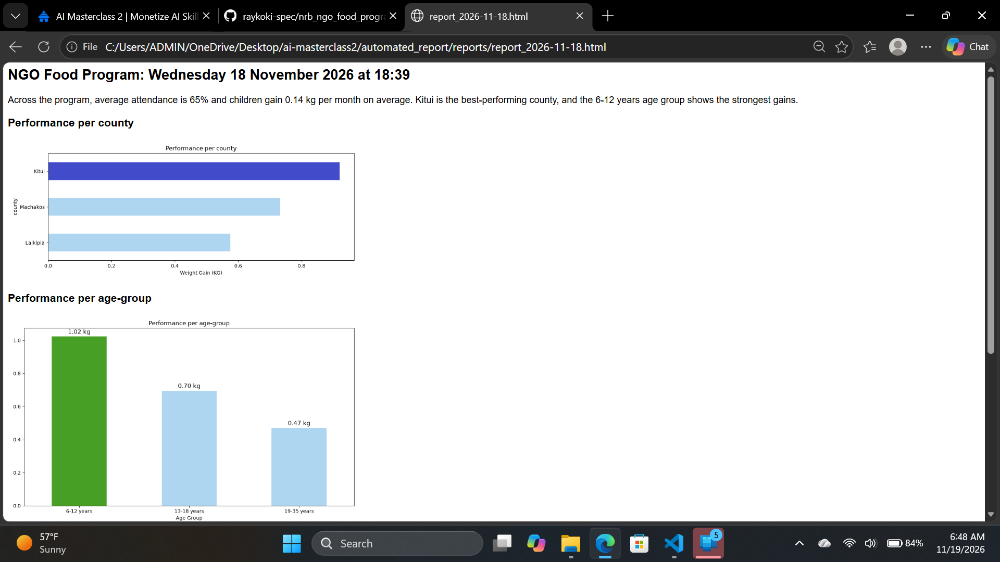
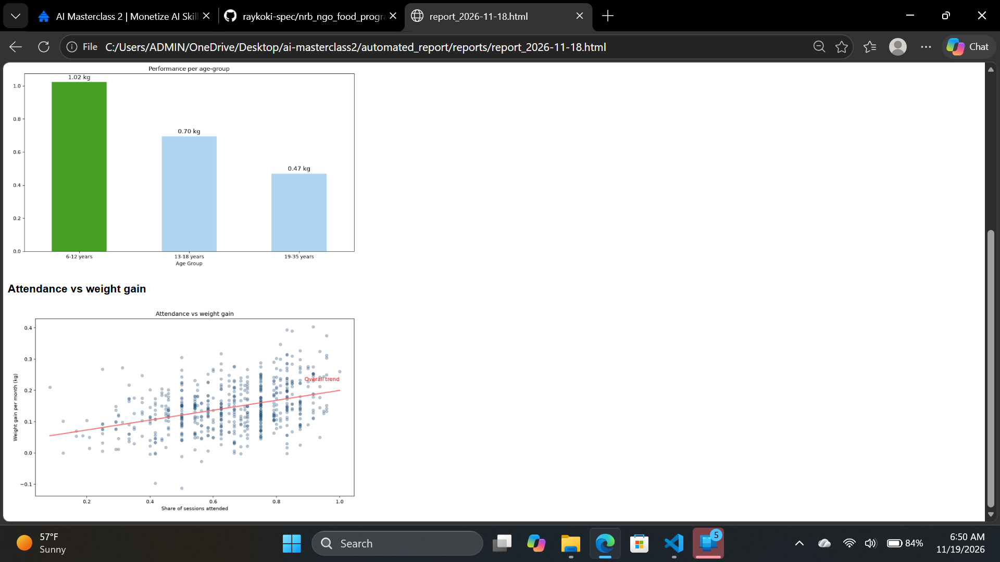

 # Nairobi NGO Foob Program: Automated Report

A Python script that turns the nutrition program CSV into a self-contained HTML report every Monday at 7:00 am, with no manual work from the program director.
The report is a single .html file. She can open it in any browser, print it, or forward it by email. The charts are embedded inside the file, so nothing else needs to be attached.


## What the report contains

- The report date in the title, so the reader knows it is current
- A one-paragraph summary: average attendance, average weight gain per month, best county and best-performing age group
- Three embedded charts:
1. Best county by average weight gain

2. Best performing age-group by average weight gain

3. Attendance vs weight gain, a scatter plot with a trend line


Each run is saved as a dated file, for example reports/report_2026-11-23.html, so earlier reports are never overwritten.





## How it works

- Reads nutrition_data.csv
- Calculates attendance rate and weight gain per month for each child
- Generates the three charts as PNG files with Matplotlib
- Encodes the charts as base64 and builds one HTML file
- Saves it to reports/report_YYYY-MM-DD.html
- Writes the result (success or error) to report.log


## Setup

```bash
pip install -r requirements.txt
```

## Usage

Run the program from the project's folder where the nutrition_data.csv file is saved.

```
python gen.py
```

## Scheduling: every Monday at 7:00 am (schedule library)

gen.py contains this line:

```python
schedule.every().monday.at("07:00").do(daily_job)
```

Leave the script running:

```bash
python gen.py
```
It checks the clock every 60 seconds and builds the report on Monday at 07:00. The computer must be on and the script must be running at that time.


## Pricing note

KES 5,000 for monthly retainer. KES 35,000 for weekly automated report.

## Stack

- **Python**
- **Matplotlib**
- **pandas**
- **numpy**
- **schedule**

